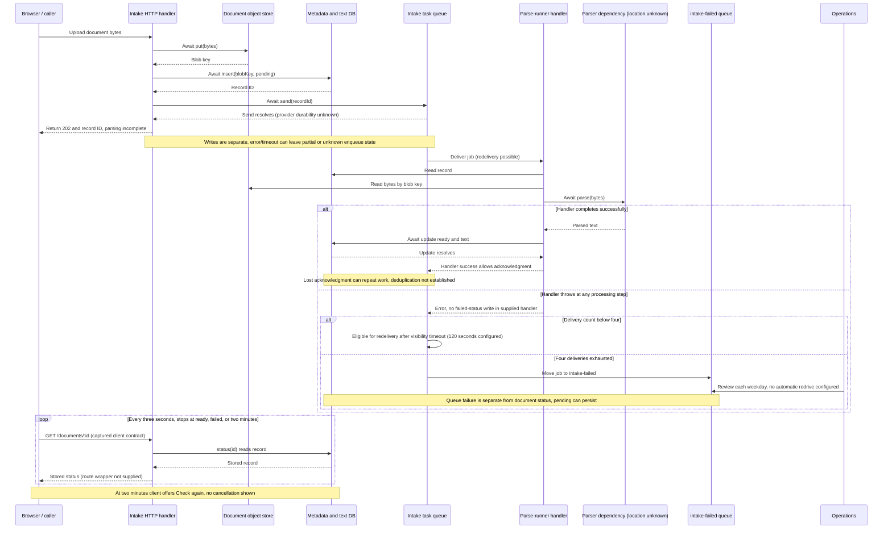
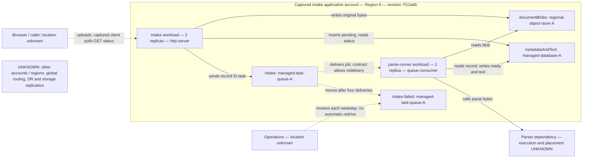

# Post-freeze syntax correction

This separate copy replaces semicolon punctuation with commas inside sequence-diagram blocks only. It is not a new assessment or an original-run pass; architecture content is unchanged. Original captions below retain the runner’s historical inspection limits. Coordinator parsing of this correction is recorded separately; no rendering or operational check is implied.

# Editable document ingestion diagrams

These Mermaid blocks are source-only models of supplied revision `7f12a6b` and captured inventory, not observed live operation. They were manually reconciled with the evidence, not parsed or rendered. “Captured” identifies supplied release/configuration evidence; “unknown” identifies a missing fact; no proposed system is included. File locators are relative to `snapshot/`.

## Runtime: where does ingestion complete or fail?

Scope: one upload, queue processing and client status observation. Implementation: `intake.ts:2–15`. Captured queue/client contract: `client-and-operations.md:2,4`. Visibility/attempt configuration: `deployment.yaml:13–15`. Browser route mapping is supplied only by the client capture. Diagram source separates the handler from the queue's acknowledgment contract.

The final polling loop is drawn after processing to keep the branches readable; in the captured client behavior polling can overlap queue processing. The exception branch applies to reads, parse and update, not merely parser rejection. If update took effect before an uncertain return or acknowledgment, stored status can already be `ready` even when delivery later fails. No `failed` transition is drawn because no writer is supplied.

## Deployment: where are the captured executables and stores?

Scope/status: rendered inventory at 2026-11-05 09:00Z, intake application account only, release `7f12a6b` (`deployment.yaml:1–22`); release completion is recorded, not independently observed (`client-and-operations.md:6`). Boxes group placement, not transactions or trust zones. Solid arrows identify implementation calls; dotted arrows identify capture-only relationships or unresolved placement. Locations outside this account, network paths and trust boundaries remain unknown.

Node evidence: intake/parse-runner names, entrypoints and counts `deployment.yaml:5–12`; stores/queues `deployment.yaml:16–21`; Region A `deployment.yaml:3`; account scope `deployment.yaml:22`. Edge evidence: implementation calls `intake.ts:3–5,8,11–14`; delivery/dead-letter/operations `client-and-operations.md:4`; client `client-and-operations.md:2`. The parser node's placement is deliberately outside the Region A grouping to denote unresolved placement, not evidence that it runs elsewhere. The unattached unknown node records coverage limits and asserts no runtime dependency. No Region B service or active-active topology is established by these inputs.
