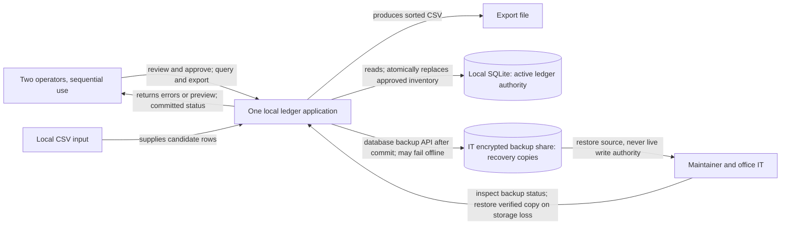

# Editable architecture views

Status: **proposed** logical/runtime model, not a deployed observation. Mermaid source only; no parsing or rendering was performed. Solid arrows are labeled data/control interactions; dashed arrows in the sequence are replies, not durability promises.

## Context: what must operators and maintainer depend on?

Scope: retain the documented single-desktop operating envelope, propose visible recovery/backup handling. The application boundary is one local deployment, not three services. Basis: `snapshot/requirements.md:2–11`, `snapshot/operations.toml:1–15`; query/export and backup interfaces are proposed because their implementation is absent.



No internet dependency for queries/imports. The backup share is outside the local availability boundary. Encryption, desktop replacement and share management follow supplied IT ownership; backup success is not implied by import success.

## Runtime: where can import fail, and what does restart recover?

Scope: validation failure, approval, atomic replacement, commit-observation gap and backup. Facts: parsing/preview/approval source shape in `snapshot/ledger.py:5–16`. Proposals: approval binding, import identity, explicit status and recovery branches. Assumptions to verify: configured SQLite transaction/recovery behavior and functioning storage. No WAL-versus-rollback mode is asserted.

```mermaid
sequenceDiagram
    participant O as Operator
    participant A as Local ledger application
    participant D as SQLite active ledger
    participant B as IT backup share
    O->>A: Select CSV
    A->>A: Parse and validate all candidate rows
    alt Invalid CSV or validation errors
        A-->>O: Errors; not accepted
        Note over A,D: No ledger write
    else Valid candidate
        A-->>O: Preview exact candidate; not committed
        alt Cancel or restart before approval
            Note over A,D: Discard preview; active ledger unchanged
        else Explicitly approve exact candidate
            A->>A: Check approval binding and validation
            A->>D: Begin transaction; replace inventory and record import identity
            alt Failure or crash before commit
                Note over A,D: On reopen, SQLite rollback/recovery must preserve prior complete ledger
                O->>A: Restart and inspect ledger/status
                A->>D: Reopen and read committed state
                D-->>A: Prior ledger, subject to verified recovery assumptions
                A-->>O: Import not committed; review before a new approval
            else Commit succeeds
                D-->>A: Complete new ledger and import identity committed
                alt Application survives
                    A-->>O: Import committed; backup status separate
                else Crash before success display
                    O->>A: Restart; previous result unknown
                    A->>D: Reopen and inspect committed import identity
                    D-->>A: New ledger and identity
                    A-->>O: Show committed import; do not blindly reapply
                end
                A->>B: Back up committed database, or retry pending backup on restart
                alt Share available and backup verified
                    B-->>A: Backup complete
                    A-->>O: Show verified backup date
                else Share offline or backup fails
                    A-->>O: Show backup pending/failed and last verified backup age
                    Note over O,A: Continue local use; retry later and flag recovery-target risk
                end
            end
        end
    end
```

Storage-loss fallback is a separate recovery scenario; it does not imply transaction rollback can repair failed hardware. Basis: recovery objective `snapshot/requirements.md:10–11`, configured backup/drill `snapshot/operations.toml:6–10`.

```mermaid
sequenceDiagram
    participant O as Operator
    participant M as Maintainer and IT
    participant B as Backup share
    participant A as Local ledger application
    O->>M: Local ledger cannot be opened or storage failed
    M->>B: Select and verify recovery copy and its business date
    alt Suitable copy available
        B-->>M: Verified database backup
        M->>A: Restore to safe replacement location; reopen and inspect
        A-->>O: Show restored ledger and recovery date before resuming
        Note over O,A: Newer imports may be absent; reconcile from known approved inputs
    else No suitable copy or share unavailable
        M-->>O: Recovery blocked; target at risk
        Note over M,B: Escalate storage/share recovery; do not claim prior-day restoration
    end
```
