# Editable refund behavior diagrams

These are proposed logical runtime/state views, not deployment diagrams. Source basis: `snapshot/worker.py:3–16`, `snapshot/contracts.md:2,4,6`, `snapshot/policy.md:2–8`; proposal details and received finance direction are in `assessment.md`. No parsing, rendering or runtime checking was performed. Solid arrows indicate requests/commands, dashed arrows observations/responses; asynchronous delivery is explicitly labeled. Time spacing is not measured time.

## Where acceptance, external effect and acknowledgment diverge

Question: how does a timed-out refund recover without losing accepted work or changing its business identity? Scope: one approved refund and its same-ID redelivery. All new records/roles/actions shown are proposed. Database atomicity and payment retention are supplied contracts, not verified deployment facts. Relay, worker and recovery are logical responsibilities and need not be separate services.

```mermaid
sequenceDiagram
    participant C as Caller
    participant A as Refund API
    participant D as Refund database
    participant R as Outbox relay
    participant Q as Existing queue
    participant W as Worker or recovery
    participant P as Payment provider
    participant F as Finance
    C->>A: Create with client_request_id and approved payload
    A->>D: Atomic unique request + refund + outbox commit
    D-->>A: Acceptance committed; stable refund ID
    A-->>C: Accepted, not payment completion
    Note over C,A: Lost response: repeat same identity returns same ID; changed payload conflicts
    R->>D: Read pending outbox
    R->>Q: Publish refund ID; repeats possible
    Q-->>R: Durable publication confirmation required
    R->>D: Mark published
    Q-->>W: Async delivery; lease may expire and overlap
    W->>D: Atomic claim; persist stable key, payload, send-intent, earliest dispatch
    D-->>W: Claim and attempt committed
    W->>P: POST same key and exact payload within safe window
    Note over D,P: Provider effect is a separate commit; no distributed transaction
    alt Success result received
        P-->>W: Confirmed provider ID
        W->>D: Commit succeeded + evidence + audit
        D-->>W: Local completion committed
        W->>Q: Acknowledge this delivery
    else Timeout or worker crash after send-intent
        Note over W,P: Effect unknown; crash recovery scans expired claims
        W->>D: Commit unknown + durable recovery obligation + audit
        D-->>W: Recovery handoff committed
        W->>Q: Acknowledge only after durable handoff
        W->>P: Scheduled GET by same key within retention
        alt Lookup confirms success
            P-->>W: Original result and provider ID
            W->>D: Commit succeeded + reconciliation evidence
        else Not found or temporarily unavailable
            P-->>W: Inconclusive observation
            Note over W,P: Before 90s not-found is inconclusive; later absence alone is not no-effect proof
            W->>D: Persist next lookup or contract-safe same-key retry
            Note over W,P: Never reset original window; no boundary-risk or fresh-key automatic POST
        end
    end
    opt Unresolved when safe retention window ends
        W->>D: Commit held + review obligation + evidence
        W->>F: Escalate unresolved refund via durable review workflow
        Note over D,F: No automatic new key; recorded finance decision required
        F->>D: Record evidence-based outcome or authorized decision
    end
    Q-->>W: Duplicate refund ID delivered
    W->>D: Read authoritative state and durable recovery obligation
    Note over D,W: Terminal: no provider call; active/unknown: recover same identity, never new business refund
    W->>Q: Acknowledge only with terminal or durable recovery state
```

Failure interpretation: if local completion/recovery commit fails, the acknowledgment shown does not occur. If acknowledgment is lost, redelivery consults database state. A claim token only fences database writes, not an already-running provider call. Concurrent same-key POST and safe expiry semantics are technical contract gaps to validate; the picture does not promise global exactly-once effects.

## What the refund store may assert

Question: which evidence permits a durable outcome, and what happens when lookup expires? Scope: one database-owned refund lifecycle; all transitions are proposals. `Prepared` means a POST might have occurred, including a crash between intent commit and actual send. `Pending` may wait ten days without a provider window starting only if no send-intent was ever recorded. State names match the assessment semantically: `Succeeded` is local completion; `Held` is unresolved, not failure.

```mermaid
stateDiagram-v2
    [*] --> Pending: Atomic acceptance and recovery intent committed
    Pending --> Prepared: Claim and first possible send intent committed
    Prepared --> Succeeded: Provider success evidence committed
    Prepared --> Unknown: Timeout or expired claim recovered
    Prepared --> Rejected: Definitive no-effect rejection evidence committed
    Unknown --> Succeeded: Lookup confirms original effect
    Unknown --> Prepared: Contract-safe same-key same-payload retry
    Unknown --> Unknown: Inconclusive lookup; next recovery due committed
    Unknown --> Held: Safe retention window ends unresolved
    Unknown --> Held: Payload conflict or insufficient retry contract
    Held --> Succeeded: Finance records evidence of original success
    Held --> Rejected: Finance records evidence of definitive no effect and closure
    Succeeded --> [*]
    Rejected --> [*]
    note right of Held
        Durable unresolved state and escalation
        No automatic new-key refund
        Other business action requires recorded finance decision
    end note
```



Guard on `Unknown → Prepared`: same persisted key/payload, verified provider idempotency behavior, safe retention remaining including in-flight bounds, and current database claim. It never means rekeying. Definitive rejection semantics are an unknown provider detail, so that transition is conditional on evidence. Manual new business actions are deliberately outside this lifecycle diagram; finance approval does not retroactively turn an unknown old effect into known failure.
