# Editable attachment migration diagrams

These are proposed logical/runtime views, not deployed topology. Mermaid source is editable; manually reviewed for prose consistency, not parsed or rendered. All snapshot locators are relative to this run directory. No arrow implies a DB transaction with gateway or storage. Solid arrows depict requests/transitions; dashed sequence arrows depict replies. Gateway policy-store topology and actual fleet placements are unknown and intentionally omitted.

## Request and authorization path

Question: how can the same GET/cookie interface enforce new policy without an owner-only outage fallback? Scope: legacy/shadow and enforcing request branches. Existing source basis: `snapshot/current.py:2-10`; compatibility/gateway contract: `snapshot/contracts.md:2-6`; proposed routing, audit and shadow semantics constrained by `snapshot/migration-policy.md:4-9`. Policy-version transport is unresolved: the current gateway contract exposes only allow/deny/unavailable.

```mermaid
sequenceDiagram
    participant C as Existing or new client
    participant A as Existing app endpoint
    participant S as Existing session verifier
    participant D as Existing relational DB
    participant G as Internal authorization gateway
    participant O as Existing private object storage
    participant T as Proposed decision telemetry
    C->>A: GET /attachments/opaque_id with existing cookie
    A->>S: Verify session identity
    S-->>A: Account (invalid-session behavior remains existing)
    A->>D: Resolve row and authoritative cohort floor/mode/revision
    alt Metadata or control state unavailable
        A-->>C: 503; never guess legacy
    else Row absent
        A-->>C: 404
    else Legacy or shadow; never enforced
        Note over A,G: Shadow comparison cannot change current response or wait on gateway
        A->>T: Schedule bounded comparison if shadow enabled
        alt Owner matches
            A->>O: Read original storage key
            O-->>A: Bytes or storage unavailable
            A-->>C: 200 bytes or 503
        else Not owner
            A-->>C: 404
        end
        T->>G: Shadow authorize(account_id, attachment_id)
        G-->>T: allow / deny / unavailable
        Note over T: Record comparison, switch revision, decision source and evaluated version when contract exists
    else Enforcing or degraded enforcing
        A->>G: authorize(account_id, attachment_id)
        G-->>A: allow / deny / unavailable
        A->>T: Record actual source, mode/revision, outcome, evaluated version
        alt allow (and any extra degraded-mode restriction permits)
            A->>O: Read original storage key
            O-->>A: Bytes or storage unavailable
            A-->>C: 200 bytes or 503
        else deny or extra restriction rejects
            A-->>C: 404; same public absence response
        else unavailable / timeout / invalid result
            A-->>C: 503; no storage read; no owner-only fallback
            Note over C: Supported mobile client retries 503 at most twice
        end
    end
```

`T` is a logical telemetry/bounded comparison responsibility on existing app facilities, not a proposed always-on worker or datastore. Its scheduling/delivery is best effort and not a guarantee of durable job execution. Required complete decision attribution for pilot must be established before progression; missing comparison/version coverage blocks evidence, not authorization. A gateway answer provides no state transaction with object storage. The diagram omits in-flight revocation semantics because security must clarify that acceptance boundary; it does not promise a whole transfer ends within 60 seconds.

## Cohort migration and rollback failure path

Question: what may abort/rollback change without reviving revoked access? Scope: app-owned durable cohort control lifecycle, proposed. Sources: `snapshot/migration-policy.md:4-8`, `snapshot/contracts.md:6`; numeric abort triggers are subsequent human direction recorded in `assessment.md`.

```mermaid
stateDiagram-v2
    [*] --> Legacy
    Legacy --> Shadow: Enable bounded comparison
    Shadow --> Legacy: Disable comparison before enforcement
    Shadow --> Enforcing: Gates pass and durable floor set
    Enforcing --> Enforcing: Expand cohort only after evidence review
    Enforcing --> Degraded: 503 or latency gate aborts pilot
    Enforcing --> Blocked: Confirmed leak; abort immediately
    Degraded --> Blocked: Evaluator correctness uncertain
    Degraded --> Enforcing: Gateway recovers; revocation checks pass; owner approves resume
    Blocked --> Enforcing: Trustworthy evaluator restored and gates reviewed
    note right of Degraded
        Stop expansion; sharing feature may be disabled
        Gateway still required for every allowed read
        Unavailable returns 503
        No transition back to Legacy
    end note
    note right of Blocked
        Affected enforcing cohorts return 503
        Preserve policy, revocations and durable floor
        Never use old owner-only binary on these cohorts
    end note
```



The durable `ever_enforced` floor is a proposed additive field on existing relational DB, not present in inspected code. Mode/floor read failure returns 503. Lost/stale configuration cannot authorize legacy fallback. Rollback never deletes bytes, owner metadata, URL mappings or revocation history; old clients retain protocol compatibility but may observe 503 during recovery. Cohort states are not attachment data states. No state transition here claims an implemented atomic commit or observed rollout.
