# Editable transfer lifecycle diagrams

All transitions below are proposed. Logical participants, not deployment instances. Device capabilities and hard constraints come from `snapshot/transfer-spec.md:2-6` and `snapshot/approved-constraints.md:2-6`; prototype behavior is not modeled as implemented future behavior. Solid messages represent the explicitly labeled local action, one-way file transfer or physical paper movement; there is no implicit reply across the device. No syntax parser or renderer was run.

## 1. How can A commit while S still lacks acknowledgment?

Scope: one manifest, including delayed/replayed members and the approved physical return. Trust enrollment and aggregate finalization are unresolved obligations (assessment steps 4–6), explicitly conditional here. S-ledger is authoritative for S knowledge/retention; A-ledger is authoritative for archive effects.

```mermaid
sequenceDiagram
    participant S as S exporter and local ledger
    participant D as One-way device
    participant A as A importer and local ledger
    participant C as Custodian with paper
    participant O as Authenticated S operator
    S->>S: Persist original, immutable manifest and transfer ID
    S->>D: Submit bounded files with stable identity
    Note over S,D: Submission is not delivery or archive acknowledgment
    Note over D,A: May lose, corrupt, duplicate, reorder or delay up to 36 hours
    D->>A: Emit members and manifest in arbitrary order
    alt Incomplete, corrupt, conflicting or authenticity unestablished
        A->>A: Stage or quarantine; no complete receipt
    else Complete, verified and authentic approval established
        A->>A: Commit each archive record plus member receipt atomically
        A->>A: Finalize complete receipt after all members committed
        Note over A: Aggregate finalization capability is an implementation obligation
        A->>C: Print committed transfer ID, manifest digest and count
        Note over S,A: S remains awaiting evidence; A may already be complete
        C->>O: Carry paper once each workday
        O->>S: Enter ID, digest and count; compare paper and confirm
        alt Exact valid match and first confirmation
            S->>S: Record explicit acknowledgment; start 45-day retention
        else Duplicate valid entry
            S->>S: No-op; preserve first acknowledgment deadline
        else Unknown or mismatched entry
            S->>S: Reject entry; retain pending state and data
        end
    end
    opt Missing valid paper acknowledgment
        O->>S: Review transfer and authorize retransmission
        S->>D: Resubmit same manifest and identity
        D->>A: Replay may overlap original delayed input
        A->>A: Exact duplicates reuse progress or committed receipt
        Note over A,C: Reprint same committed receipt on later local custodian round
    end
```

There is intentionally no A→D→S response arrow. A's print is not an S acknowledgment until verified manual entry; transport acceptance is not A commit. Printing from incomplete progress is forbidden.

## 2. Which evidence changes S's lifecycle and retention?

Scope/status: proposed S-owned state machine. Based on retention/review constraints (`snapshot/approved-constraints.md:4-6`) and absence of delivery evidence (`snapshot/transfer-spec.md:2`). Archive completion is deliberately not a source-observable state without paper evidence.

```mermaid
stateDiagram-v2
    [*] --> Preparing
    Preparing --> Ready: Originals and immutable manifest durably recorded
    Ready --> AwaitingEvidence: Submission attempted or outcome uncertain
    AwaitingEvidence --> AwaitingEvidence: Missing paper or age alert; retain data
    AwaitingEvidence --> AwaitingEvidence: Human reviewed resend with same intent
    AwaitingEvidence --> AwaitingEvidence: Mistyped or mismatched entry rejected
    AwaitingEvidence --> AcknowledgedRetaining: Exact paper match and explicit confirmation
    AcknowledgedRetaining --> AcknowledgedRetaining: Repeated valid entry; unchanged deadline
    AcknowledgedRetaining --> ReviewHold: Mistaken acknowledgment discovered
    ReviewHold --> AwaitingEvidence: Acknowledgment invalidated and audited
    ReviewHold --> AcknowledgedRetaining: Evidence reviewed and fresh confirmation recorded
    AcknowledgedRetaining --> PurgeEligible: 45 full local days elapsed and no hold
    PurgeEligible --> ReviewHold: Correction concern raised before deletion
    PurgeEligible --> Purged: Audited local retention cleanup
    Purged --> [*]
```



Local storage pressure invokes an admission hold and operator escalation alongside these states; it never causes `AwaitingEvidence → PurgeEligible`. A confirmed receipt does not guarantee restoration after later deletion. Readiness and retention transitions require actual durable implementation verification.

## 3. How does A avoid treating replay or partial imports as a completed transfer?

Scope/status: proposed A-owned processing state. `AuthenticatedAndComplete` is conditional on trust enrollment and approval verification, not supplied capability. `CompleteReceipt` additionally requires safe aggregate finalization or complete per-member receipt matching as described in the assessment.

```mermaid
stateDiagram-v2
    [*] --> Staged
    Staged --> Incomplete: Manifest or members absent
    Incomplete --> Staged: Delayed or reviewed replay input arrives
    Staged --> Quarantined: Bad digest, binding conflict or trust unresolved
    Quarantined --> Staged: Local investigation resolves cause and evidence permits revalidation
    Staged --> AuthenticatedAndComplete: All bytes and approved origin verified
    AuthenticatedAndComplete --> CommittingMembers: Begin replay-safe local member commits
    CommittingMembers --> CommittingMembers: Commit archive record plus member receipt atomically
    CommittingMembers --> CommittingMembers: Crash recovery or exact replay resumes ledger progress
    CommittingMembers --> CompleteReceipt: All members committed and membership finalized
    CompleteReceipt --> CompleteReceipt: Exact replay or reprint; no repeated archive effect
```



A conflicting same-key payload is quarantined without changing an existing committed receipt or archived version. An older immutable version never overwrites a newer version. No automatic expiration/replay transition removes durable deduplication bindings. The arrows are design rules, not observed branches or runtime tests.
