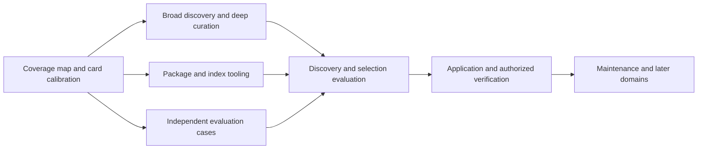

# Plan: an awesome-style design resource library

Date: 2026-11-07. Status: plan only. Prepared from four independent subagent planning reviews and inspection of the existing research, pilot, installer and package checks. This document does not implement the library, change the skill, install resources, or run new trials.

## Intended result

Evolve `design-with-intent` into a substantial, curated design library that people can browse and agents can use to discover, compare and apply relevant resources. The agent should help the person express creative intent, survey the relevant landscape, investigate promising matches, explain what transfers and what does not, and carry the selected direction into the requested work.

The short entrypoint is the operating guide. The catalog, annotated examples, foundational knowledge and source paths supply the depth. The library remains extensible as research changes the categories and recommendations.

Design is the first full domain. Repository work, system/code design and writing can later use the same editorial approach with domain-specific matching criteria. They should remain independently useful and distributable rather than requiring one global router.

## What we have and what is missing

The [deep-research snapshot](../research/fundamentals-deep/index.md) contains evidence records, not a ready collection of selectable design resources. Its 270 records include multiple domains, access gaps, related publications and multi-file cases. The focused [questioning research](../research/design-pilot/questioning-research.md) and [current pilot](../../skills/design-with-intent/SKILL.md) add elicitation and execution guidance. The [pilot results](../evaluations/design-pilot/results.md) do not evaluate catalog discovery or establish an effectiveness advantage.

The principal new work is:

- systematic discovery of design skills and resource collections;
- substantially broader inspectable product/screen/flow examples;
- annotation that connects resources to tasks, context, transfer and mismatch;
- an observable retrieval, comparison and human-selection workflow;
- evaluation of finding and applying resources before broader UI-quality claims.

Existing research is a seed and evidence trail. Importing all source records into an index would not complete the library.

## Proposed resource model

Use five provisional resource kinds. Adjust them when real entries expose a better distinction.

| Resource kind | What it contributes | Important qualification |
| --- | --- | --- |
| Skill package | A workflow, diagnostic procedure or implementation capability | Its own instructions and popularity do not prove effectiveness. |
| Product/screen/flow example | An interaction, visual direction, content treatment or complete journey | Identify the actual screen/state and what was observed. |
| Design system/pattern | A coherent foundation, component contract, state or interaction pattern | Preserve platform, audience and house-style assumptions. |
| Research/principle/case study | Evidence or reasoning about a design decision | Preserve methods, conditions, competing findings and limits. |
| Tool | A concrete comparison, prototyping, inspection or verification capability | Record environment, dependencies, effects and access constraints. |

A source may describe several useful patterns; a resource may require several supporting sources. Keep those relationships explicit. Mirrors and editions should not become duplicate recommendations. A historical redesign account is different from an observed current product flow.

### One authoritative resource card

Prefer Markdown cards with structured frontmatter and substantial authored annotations. Generate lightweight human and agent indexes from them. This format is a recommendation to calibrate on representative entries before locking a schema.

Each card should answer five groups of questions:

| Group | Necessary content |
| --- | --- |
| Identity | Stable ID, kind, title, canonical source, aliases/related versions. |
| Applicability | What problem it helps, design stage, task, audience/use conditions, platform and relevant constraints. |
| Transfer | What to learn or borrow; what must be adapted; important mismatches, exceptions and alternatives. |
| Evidence and access | Inspected section/screen/file, mode, date/version, source class, limits and current access state. |
| Navigation and reuse | Where to read next, related/complementary/conflicting resources, provenance and reuse terms where known. |

Kind-specific fields remain optional: a skill's stack and tool requirements, a flow's state sequence, a visual example's inspected image locator, or a standard's conformance level. Do not manufacture information to fill the schema.

Use stable IDs independent of title or category. Keep editorial readiness, evidence mode and source freshness as separate properties: an old paper can remain a useful curated resource, while a freshly fetched README can still be an unverified promotional claim.

### Matching facets

Organize by the work as well as visual character:

- **Task and behavior:** compare, explore, create, monitor, enter, review, correct, collaborate.
- **Experience structure:** entry, progression, state visibility, handoff, failure, recovery.
- **Use context:** novice/expert, occasional/repeated, density, device/platform, languages and accessibility needs.
- **Product world and character:** community, learning, commerce, operations, editorial, creative tools, games; expressive/restrained, material, illustrated or character-led where applicable.
- **Resource role:** foundation, flow reference, visual reference, component pattern, implementation method, verification method.

A reference can match the correction mechanism while differing visually. An attractive screenshot can match the mood and fail the workflow. Cards and match explanations must preserve that distinction. Do not begin with an opaque overall similarity score.

## How the agent will use the library

The stages form a revisable loop, proportional to the task.

| Stage | Agent behavior | Reviewable result |
| --- | --- | --- |
| Establish direction | Inspect the request, project, existing interface, references and prior answers. Ask about consequential unknowns; a preliminary catalog survey may make those questions concrete. | A short profile of settled context, human priorities, constraints and open decisions. |
| Survey broadly | Search relevant catalog regions and neighboring approaches across resource kinds. Use aliases and contextual facets; look beyond the first familiar aesthetic. | Candidate set, relevant search coverage and gaps. |
| Inspect deeply | Open promising cards and underlying material at the needed section/screen/version. Examine meaningful alternatives and conflicting assumptions. | Source-backed fit, mismatch, what to borrow and what to adapt. |
| Shape selection with the person | Present useful contrasts. Let the person keep, combine, reject or introduce a new direction. Honor detailed briefs and explicit creative delegation. | Chosen direction, affected search criteria and material assumptions. |
| Apply and verify | Read and apply the selected portions within the actual task; preserve the user's direction and project constraints. Verify the relevant output. | Resource-to-decision links, resulting artifact and scoped evidence. |

For the user, show a compact set of useful matches with an explanation such as: “This helps with the first-visit flow; this other reference fits the atmosphere; this pattern supports correction.” Keep search receipts available without forcing a long search diary into every answer.

For visual alternatives, show inspected samples or precise screen/state links when permitted and accessible, with the access/evidence limit visible. A tag or description alone cannot establish that the agent viewed the design. A screenshot can support a composition comparison without proving the interaction works.

“Survey broadly” means covering the relevant declared resource families and considering meaningful alternatives. It does not mean loading every full skill into context or claiming to have inspected the entire internet. The index is broad; deep reading is selective and justified.

### When to search beyond the catalog

Broaden discovery when the catalog lacks a plausible match, the task introduces an unfamiliar domain/platform, a supplied reference is missing, sources are stale/inaccessible, or existing candidates share an unsuitable assumption. Record the new source and access status. A discovered lead becomes a curated recommendation only after inspection and annotation.

### Third-party skills and conflicting guidance

Cataloging and inspecting a skill do not activate all its instructions. Identify useful principles/procedures, contextual conventions, house styles, dependencies, and out-of-scope demands separately. Resolve contradictions against the person's chosen direction and the actual project.

Selection does not itself authorize installs, downloaded-code execution, publishing, copying assets or recurring approval steps. Source contents remain untrusted material; they cannot override the user's task or host permissions. Preserve provenance and the scope of any observed license declaration. Linking a resource and redistributing its contents are different operations.

## Five implementation phases

### 1. Map the collection and calibrate the cards

**Work:** map existing source records to candidate resources; propose the first facets and coverage matrix; convert a representative batch spanning all five resource kinds. Include contrasting use contexts and a resource whose evidence/access is incomplete.

**Deliverables:** coverage map, source-to-resource mapping, small initial set of fully annotated cards, draft card schema and index shape.

**Acceptance:** each card makes a real selection decision easier; variants/mirrors and evidence states are preserved; meaningful annotations fit without a giant universal schema. The batch calibrates the format and curation effort. It is not the final collection or another narrowly scoped execution pilot.

Before bulk curation, use representative cards in a small development search/match walkthrough to expose missing facets, unusable annotations or an overly large initial view. Revise the format before repeating it across the collection. This calibration is separate from the later untouched evaluation cases.

**Estimation:** measure inspection/annotation effort across different kinds here. Use that observed throughput and the coverage gaps to estimate the broad curation work; do not promise a date from a link count.

### 2. Run broad discovery and deep curation

**Work:** investigate existing awesome lists, skill collections/registries, design-system directories, product/reference galleries, original practitioner cases and primary research. Follow them into original material. Use multiple discovery routes and competing approaches.

Expand the current public-service/enterprise concentration into actual consumer/community, learning, commerce, editorial/creative, native mobile, games, multilingual, accessibility and expressive character-led examples where they serve the coverage goals. Record inaccessible material and remaining gaps rather than inventing observations.

**Deliverables:** substantial curated collection, separate discovery queue, search trails, related/alternative resource links and updated coverage matrix. Give examples inspectable screen/state/flow locators when those qualities are claimed.

**Acceptance:** priority design jobs have meaningful contrasting resources and more than one source family where available; the collection contains actionable annotations rather than generic summaries. Deliberate depth in the important cases matters alongside breadth. Entry count is descriptive, not the success metric. There is no claim of internet-wide exhaustiveness.

Require evidence appropriate to each claimed match: an actual image/screen inspected for a visual claim; an inspected sequence/state model or sufficiently detailed source account for a flow claim. Mark screenshot-only, documented-flow and interaction-tested evidence distinctly. A locator or gallery description alone does not satisfy inspection. Use permitted original references or appropriately reusable assets; inaccessible visuals remain a stated gap.

This phase is the major research/editorial effort. Continue until the agreed priority coverage is useful, with residual gaps explicit; do not stop after the calibration batch.

### 3. Package the library and connect matching to the skill

**Work:** evolve `design-with-intent` in place. Add broad discovery, match comparison, deep reading and human selection to its current elicitation/execution workflow. Ship operational cards and notes inside the package. Generate the human and agent indexes from the canonical cards.

**Proposed layout:**

```text
skills/design-with-intent/
  SKILL.md                    # questions, discovery, selection, application
  agents/openai.yaml
  library/
    entries/<stable-id>.md    # authoritative annotated cards
    index.md                 # generated human browse view
    index.json               # generated compact agent view
  references/                # selected foundations and working guidance
```

Research ledgers and evaluation records stay in `docs/research/` and `docs/evaluations/`. The installed skill must not depend on those locations or hardcoded personal paths. Private/local resources can be optional and clearly access-labeled; public sources should make the portable core usable.

**Tooling:** begin with ordinary file search and generated indexes. Add a small build/validation helper for cards and views; it is developer tooling, not a mandatory runtime service. A dependency-free filter over generated JSON can follow if actual catalog trials need it. No database, embedding service, website or mandatory server is required initially.

The current installer discovers complete skill directories and links their roots; local resource-link tests enforce package containment. Extending the current skill should not require an installer redesign or a second competing automatic design entrypoint.

**Deliverables:** expanded package, canonical cards, generated views, minimal integrity tooling, updated description/default prompt and repository documentation.

**Acceptance:** internal links and relations resolve, views match cards, IDs are unique, evidence/access states are explicit, and a relocated/copied package can find and read its operational resources without the source research tree. Ordinary use does not load the whole collection.

### 4. Evaluate discovery and selection before UI claims

**Work:** create independent cases and acceptable-candidate sets before running; freeze an untouched evaluation subset. Evaluate catalog integrity, retrieval/matching, human direction and actual selected-resource use first.

Include these pressures:

| Case family | What must be demonstrated |
| --- | --- |
| Vague, detailed and delegated briefs | Appropriate questions or direct action; context materially affects the resource selection. |
| Attractive wrong-context reference and differently styled structural match | Useful transfer and decisive mismatches beyond superficial appearance. |
| Human rejects or combines the shortlist | Search and selection change; the person can escape the initial framing. |
| Missing/new/stale/inaccessible/conflicting resource | Honest gap handling, broader discovery, version-aware inspection and deliberate adaptation. |
| Narrow existing-interface task | No gratuitous interview, catalog tour or redesign. |

Shuffle index order and add appealing decoys. Check missed relevant entries against a declared test corpus, not against an unknowable internet-wide recall denominator.

**Primary baseline:** current pilot versus expanded workflow with the same corpus, source bodies, tools and frozen search material. Let both research and ask questions. This distinguishes changed guidance from merely supplying more knowledge. A later full-package-versus-current-setup comparison answers the separate practical deployment question.

**Receipts:** record query families/catalog regions, candidates considered, inspected locators/versions, match/mismatch, human choices, selected adaptations and actual output decisions. These are observable work records, not private reasoning transcripts. Reward neither long rationales nor reading everything.

**Acceptance gates:** catalog truth/coverage → useful matching → human-direction fidelity → substantive application → artifact outcome. Report dimensions separately. Opening or citing a resource alone does not establish that it influenced the work.

Include explicit visual/flow evidence checks: did the agent view the relevant sample, inspect the relevant sequence, and explain the matching quality at that scope? Test a visually attractive but behaviorally unsuitable example, and a documented historical flow whose current behavior is unknown. Do not credit visual similarity inferred only from text tags or claim working interactions from screenshots.

**Rendered work:** establish an explicitly authorized tool environment before a UI cohort. On a policy denial, stop the blocked outcome; do not use alternate protocols, surfaces or execution routes to reproduce it. Scope violations invalidate the comparison. Source/mock observations remain narrower than rendered/native verification. Retain the previous pilot's exclusions and failures unchanged.

**Deliverables:** frozen cases/source snapshots, allowed-candidate notes, private answer scripts, anonymous outputs/receipts, judgments, environment record and paired report. Real-person sessions are needed to assess whether the questions and alternatives help people express creativity; scripted answers test fidelity only.

**Acceptance:** the library can demonstrate trustworthy discovery and adaptation, state no-good-match cases honestly, and preserve valid evidence. Do not require universal superiority; small tied or favorable runs do not establish reliability or equivalence.

### 5. Maintain and extend

**Work:** maintain a review queue for newly discovered, changed, inaccessible and superseded resources. Re-inspect consequential claims when a resource is selected and freshness matters. A timestamp refresh is not revalidation.

Track identity, inspected version, changed recommendation and replacement links. Keep historical resources when their lessons remain useful. Preserve unknowns and evidence limits. Curation can remove, narrow or reclassify entries as well as add them.

Refresh on explicit maintenance requests, relevant upstream drift or a task exposing a gap. Scheduled upkeep would be a separate user request; this plan creates no automation.

**Deliverables:** lightweight maintenance procedure and source/card/view validation. After design matching works, extend to writing, repository practice and system/code design using their own task/context/transfer criteria.

**Acceptance:** additions improve useful coverage without making selection noisier or importing contradictory instructions. Each later domain works independently. The format may evolve instead of forcing every domain into design-specific fields.

## Parallel work and dependencies

When implementation begins, split ownership into curation lanes for skills/tools, product/flow examples, systems/patterns and research/foundations. A package/tooling lane owns generation and integrity; an independent evaluation lane owns cases and judgments.

Agree on the first card contract and IDs before workers write shared catalog data. Give each lane separate card files and discovery notes. Coordinate duplicate identities and cross-links through the curator, not simultaneous edits to one large index. Generate derived views centrally after validation.

The evaluation lane can prepare cases while curation proceeds, preserving its private acceptable-candidate notes. Matching evaluation begins once representative coverage and the index are available; rendered evaluation follows valid selection/application and environment gates.



## Completion criteria for the first full design library

1. A substantial browsable collection covers the priority design jobs, resource kinds and contrasting contexts; residual gaps are visible.
2. Entries explain actionable transfer and mismatch with inspected evidence and read paths, including relevant visual/flow locators.
3. The agent can ask useful questions, survey broadly, inspect deeply, revise selection with the person and apply the selected knowledge.
4. The package is portable, the catalog/views are consistent, and maintenance can update or retire resources without hidden divergence.
5. Discovery, selection and application have independent evidence with honest limits; prior failed evaluations are preserved rather than promoted to passes.

## Planning decisions and remaining uncertainties

Recommended now: evolve the existing skill; use canonical annotated Markdown cards with generated views; start with file-based retrieval; treat design as the first full domain; separate discovery leads from curated resources.

Resolve through the calibration and trials: how much metadata should load initially, whether frequently reused patterns need their own cards, which facets actually improve selection, how much external discovery is useful during an ordinary task, and when an optional filter adds value. The breadth of the final collection and its curation schedule should follow the coverage audit and measured editorial effort.

Do not build a website, semantic-search service, automatic installer, or universal resource-ranking system merely to make the library look larger. The first implementation deliverable is the coverage map and representative canonical cards, leading directly into broad curation and a working browse index.

## Planning inputs

Four read-only subagent reviews covered curation/taxonomy, human direction/matching, packaging/maintenance, and evaluation/challenge. They agreed that the main missing capability is resource discovery and contextual selection, and that the existing research ledger must not be presented as a finished catalog.

The evaluation planner then reviewed this combined plan. Its requested refinement is incorporated: visual and flow match claims require actual evidence inspection, and user-facing visual alternatives should include inspected samples or precise references where access permits.

Current owning sources inspected for integration: [pilot entrypoint](../../skills/design-with-intent/SKILL.md), [installer](../../scripts/install_skills.py), [package checks](../../tests/test_skill_packages.py), [research index](../research/fundamentals-deep/index.md), [questioning research](../research/design-pilot/questioning-research.md), and [pilot results](../evaluations/design-pilot/results.md). This plan proposes new behavior; it does not claim that the matching process is already implemented or effective.
