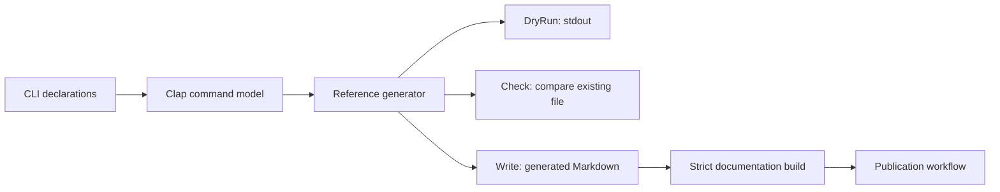

# Repository fundamentals: deep research dossier

Research date: 2026-11-07 (Asia/Seoul). Status: research and provisional synthesis; no new skills created.

## Decision implication

The most useful unit for this part of the library is a **maintainable change path**: how someone finds the relevant source, understands the boundary, edits the authoritative input, chooses meaningful checks, and carries the result into documentation and distributed artifacts. A folder tree is one representation of that path. It is not an adequate quality criterion by itself.

This is a recommendation from the evidence below, not a measured claim that one skill taxonomy outperforms another. The provisional split is repository maintainability, technical documentation, and change review. Architecture, testing, release engineering, and security are overlapping concerns to route deliberately, rather than reasons to create one comprehensive repository skill.

The first-pass proposal should therefore remain revisable. Sources sometimes disagree because they optimize different things: compact libraries versus independently published modules, rapid local feedback versus cross-platform confidence, newcomer learning versus exact reference lookup. The research should preserve those differences.

## Scope and evidence handling

The substantive ledger contains 30 evidence entries: 29 inspected source bundles/papers and one partially inspected author abstract. Three additional records document failed retrievals. A source bundle may join a contributor guide to the actual configuration or implementation it names. These are not 30 independent confirmations of one hypothesis.

Six repository cases were pinned to exact revisions before follow-through:

| Repository | Role and languages | Inspected revision |
| --- | --- | --- |
| p-limit | Small library; JavaScript and TypeScript declarations | `a8a6fbec4e0e866d6d779b10889bb4f5567e70eb` |
| uv | CLI and Python tooling; Rust/Python | `5ce34500b8a3d16d24bc7576bd8ac64879091cea` |
| Django | Application framework; Python/JavaScript/templates | `a1f2b45ce5a327f42437bdb620a817839d0bd067` |
| CPython | Interpreter and standard library; C/Python | `6c5596c7199792ea1e8cf26f65da8cd0023c0473` |
| Kubernetes | Multi-module monorepo; Go/shell | `3a92e6afd51585de38b0916494c7bf7c638b1b74` |
| MDN content | Community documentation; Markdown/JavaScript | `288e644117c29285df2acf37a2ac97f57546a146` |

The repository sample is purposive: contrasting maintenance constraints, languages, artifact types, and contribution models. Stars were not used as evidence of quality. VS Code and Rust informed preliminary reconnaissance but were not expanded into the six pinned cases, to spend time following selected chains rather than adding root listings. SQLite and Go were considered as further contrasts but not inspected in depth. No absence claim follows from those omissions.

All external code was read as evidence. No installer, source build, test, generator, publication command, or remote contribution action was executed. A configured check establishes intended mechanics, not a green run, actual branch protection, or production acceptance.

### Search trail

The initial vocabulary covered repository structure, contributor guides, documentation organization, code review, program comprehension, coverage, modularity, and complexity metrics. Representative query families were:

- `site.diataxis.fr compass tutorials how to guides reference explanation`; `site.google.github.io eng practices review reviewer looking for`.
- `github sindresorhus p-limit contributing readme package.json`; `github rust-lang rust CONTRIBUTING.md src bootstrap`, followed by direct repository contents, pinned files, and workflow inspection.
- `Bacchelli Bird expectations outcomes modern code review ICSE 2013 Microsoft`; `Sadowski modern code review Google case study ICSE 2018`.
- `software engineering documentation developer information seeking Sillito Murphy De Volder questions programming tasks 2006`; `How software engineers use documentation pdf Lethbridge`.
- `code coverage bugs empirical study Inozemtseva Holmes 2014 coverage not strongly correlated test effectiveness`; `empirical study cognitive complexity understandability programmers replication cyclomatic complexity`; `site.hbs.edu modularity software design structure matrix MacCormack Rusnak Baldwin Linux Mozilla 2006`.

Follow-through used GitHub's connected read API to inspect root directories, contributor docs, source/configuration, selected commits/issues/PRs, and workflows at the recorded SHAs. Academic discovery followed author, institution, publisher, and official research links to methods and limitations where accessible. Search snippets and inaccessible mirrors did not count as full-paper inspection.

## Six maintenance cases

### 1. p-limit: a small tree can expose a complete maintenance surface

**Trigger:** change queue clearing or iterable-mapping error behavior.

**Trace:** the manifest's exported implementation/types lead to `index.js`; tests cover rejection and iterable-error behavior; the aggregate test command joins lint, runtime tests, and declaration tests. CI invokes that command across supported Node versions. The package manifest also limits distributed files. [REP-03](https://github.com/sindresorhus/p-limit/blob/a8a6fbec4e0e866d6d779b10889bb4f5567e70eb/package.json), [REP-04](https://github.com/sindresorhus/p-limit/blob/a8a6fbec4e0e866d6d779b10889bb4f5567e70eb/index.js).

**Lesson:** choose a structure that reveals relevant relationships. Moving this small surface into layered package directories would need a concrete navigation, release, or dependency benefit. A flat tree does not imply that semantics or packaging boundaries are unimportant.

**Evidence boundary:** source and test cases were inspected; the release workflow, npm contents, and current CI results were not independently exercised. A snapshot of repository shape cannot explain why maintainers originally chose it.

### 2. uv: generated references have a different authority from authored guides

**Trigger:** change command-line help or a configuration option.

**Trace:** `cargo dev` is an alias for the development binary. The CLI-reference generator obtains Clap's command model and builds it before inspection, including propagated options, then renders `docs/reference/cli.md`. Its modes distinguish writing, printing, and comparison. [REP-07](https://github.com/astral-sh/uv/blob/5ce34500b8a3d16d24bc7576bd8ac64879091cea/crates/uv-dev/src/generate_cli_reference.rs).

The generated-files workflow runs broad generation in stdout-only DryRun mode, with separate Check calls for selected outputs. Reading that workflow alone could suggest missing drift enforcement. Further inspection changes the interpretation: both documentation validation and publication regenerate CLI/options/environment/preview references before a strict documentation build. This is consistent with build-time derivation; it does not establish a defect. The trace distinguishes generation success, checked-in freshness, and freshness of published output.

Contributor guidance favors focused snapshot scenarios and tests at the layer that owns shared parsing. Release preparation coordinates metadata and derived files. These are local choices with identifiable purposes, not universal demands that every CLI use snapshots or a development crate. [REP-05](https://github.com/astral-sh/uv/blob/5ce34500b8a3d16d24bc7576bd8ac64879091cea/CONTRIBUTING.md), [REP-06](https://github.com/astral-sh/uv/blob/5ce34500b8a3d16d24bc7576bd8ac64879091cea/AGENTS.md), [REP-08](https://github.com/astral-sh/uv/blob/5ce34500b8a3d16d24bc7576bd8ac64879091cea/scripts/release.sh).

**Evidence boundary:** no generator was run; external publication infrastructure and live documentation were not checked. Check-mode behavior was inspected for the CLI reference, not exhaustively proved for every generator.

### 3. Django: a small feature spans renderers, tests, reference, and release communication

**Trigger:** add Textarea input-type behavior, including hidden rendering.

**Trace:** a concrete six-file commit changes the widget, both Django and Jinja2 templates, regression tests, reference documentation, and release notes. Following the shared test helper reveals that Jinja2 rendering is exercised only when its dependency is present. [REP-10](https://github.com/django/django/commit/a1f2b45ce5a327f42437bdb620a817839d0bd067).

Contribution routing and test setup matter independently: the project uses Trac intake, while default tox checks do not cover every database backend or JavaScript suite. [REP-09](https://github.com/django/django/blob/a1f2b45ce5a327f42437bdb620a817839d0bd067/CONTRIBUTING.rst).

**Lesson:** “test passed” needs a scope: which renderers, backends, dependencies, and user contracts were reached? A repository skill should find that scope rather than prescribing a uniform checklist or requiring every environment for every patch. Changes to a specific database backend justify a different test selection from an isolated form template change.

**Evidence boundary:** the commit and helper were read, not executed. The inspected addition does not establish runtime equivalence across engines or all versions. No assumption that Django's intake rules should govern unrelated repositories follows.

### 4. CPython: trace the bug, review rationale, and maintenance branch separately

**Trigger:** a finalizer changes an object's class while C code still holds the old type.

**Trace:** the issue includes an ASan reproduction; the PR moves finalization bookkeeping and reloads the type after a callback. Review also changes NEWS terminology toward the Python-facing behavior. Linked backports are separate work. The merged diff contains three files and no new test. [REP-14](https://github.com/python/cpython/pull/159888).

Repository context supplies additional, distinct checks: generated build inputs, reviewer-routing groups, regeneration/ABI jobs, and platform jobs. [REP-11](https://github.com/python/cpython/blob/6c5596c7199792ea1e8cf26f65da8cd0023c0473/Makefile.pre.in), [REP-12](https://github.com/python/cpython/blob/6c5596c7199792ea1e8cf26f65da8cd0023c0473/.github/CODEOWNERS), [REP-13](https://github.com/python/cpython/blob/6c5596c7199792ea1e8cf26f65da8cd0023c0473/.github/workflows/build.yml).

**Lesson:** a precise change description should connect the trigger to the changed lifetime invariant. Neither a merged state nor an appealing code-quality metric substitutes for that reasoning. Related code, tests, and documentation can be discoverable together without physical co-location.

**Evidence boundary:** ASan output is the reporter's evidence, not a reproduction by this research. The absence of a test in this diff does not demonstrate the absence of existing coverage or prove the patch deficient. Backport links do not establish shipped releases.

### 5. Kubernetes: repository boundaries and release units are different dimensions

**Trigger:** change a library distributed through a separate Kubernetes module.

**Trace:** the staging guide identifies the monorepo copy as authoritative; workspace/module resolution connects consumers to it. Import allowlists are consumed by `hack/verify-imports.sh`, which appears in the verification driver. Publication rules describe independent branch dependencies and standalone build/test smoke steps for client-go. Root ownership filters route dependency review. [REP-15](https://github.com/kubernetes/kubernetes/blob/3a92e6afd51585de38b0916494c7bf7c638b1b74/staging/README.md), [REP-16](https://github.com/kubernetes/kubernetes/blob/3a92e6afd51585de38b0916494c7bf7c638b1b74/staging/publishing/import-restrictions.yaml), [REP-17](https://github.com/kubernetes/kubernetes/blob/3a92e6afd51585de38b0916494c7bf7c638b1b74/staging/publishing/rules.yaml).

**Lesson:** locate editing authority before treating two copies as duplication. In-repository compilation can use workspace conveniences unavailable to a released module. Conversely, a package's release independence need not imply that humans edit it in a different repository. Mechanical dependency constraints provide a more reviewable architectural signal than folder names alone.

**Evidence boundary:** verifier and publishing configuration were inspected; no bot execution, branch protection, standalone package build, or mirror synchronization was verified. Allowlist exceptions and ignored subtrees mean the policy is scoped rather than absolute.

### 6. MDN: reorganizing documentation is also a compatibility change

**Trigger:** move or delete a documentation page.

**Trace:** contributor guidance routes moves/deletions through tooling that maintains redirects and related content metadata. A separate script updates source links after moves and has a check-only mode. The redirect workflow keeps the required job present while filtering expensive work internally. Metadata has a schema and validator distinct from prose review. [REP-18](https://github.com/mdn/content/blob/288e644117c29285df2acf37a2ac97f57546a146/CONTRIBUTING.md), [REP-19](https://github.com/mdn/content/blob/288e644117c29285df2acf37a2ac97f57546a146/front-matter-config.json), [REP-20](https://github.com/mdn/content/blob/288e644117c29285df2acf37a2ac97f57546a146/.github/workflows/pr-check_redirects.yml).

**Lesson:** a documentation repository has APIs: slugs, internal links, front matter, compatibility keys, and contributor expectations. A generic file move can preserve Markdown syntax while breaking a user path. Validate the affected interface, not merely the document format.

**Evidence boundary:** the external content CLI's move/delete implementation was not inspected. Workflow source does not prove the current required-check configuration or published redirect behavior. A valid page schema says nothing about the truth of its prose.

## What empirical work supports, complicates, or leaves open

### Review quality includes understanding and participation

The Microsoft field study finds that reviews serve change understanding and knowledge transfer as well as defect detection. Its qualitative scope does not measure every claimed benefit causally. [REP-22](https://www.microsoft.com/en-us/research/wp-content/uploads/2016/02/ICSE202013-codereview.pdf).

Google's mixed-method study connects its lightweight review practice with small changes, integrated tooling, and feedback on noisy analyzer results. Those observations do not justify exporting an identical reviewer count or review-time target. [REP-21](https://storage.googleapis.com/gweb-research2023-media/pubtools/4476.pdf).

The Qt/VTK/ITK study is especially useful counterevidence to a simplistic “all changes reviewed = quality” rule: participation contributes to its models, while expertise effects vary, including differences between larger Qt and ITK. Observational defect models leave confounding and proxy limitations. [REP-23](https://rebels.cs.uwaterloo.ca/papers/emse2016_mcintosh.pdf).

**Skill implication, inferred:** make a change easy to understand and review; route to relevant knowledge; automate well-defined mechanical checks; assess whether automated feedback is useful. Comment count or completion of a review ritual is not the target.

### Coverage is a diagnostic with a limited claim

The 2014 suite-sampling study controls for suite size and finds lower coverage/effectiveness association than naive comparisons suggest. Effectiveness is measured with mutants, with acknowledged equivalence and generalization limits. [REP-24](https://cs.uwaterloo.ca/~rtholmes/papers/icse_2014_inozemtseva.pdf).

A 2017 real-defect study's author abstract reports little association across 100 Java projects. Only the abstract was inspected, so its detailed methodology is not treated as independently audited. [REP-25](https://www.microsoft.com/en-us/research/publication/code-coverage-and-post-release-defects-a-large-scale-study-on-open-source-projects/).

**Skill implication, inferred:** retain project-mandated gates, use uncovered code to direct investigation, and require an explanation of which fault or behavior a test can distinguish. These results do not show that unexecuted code is safe or that additional relevant tests have no value.

### Complexity metrics answer some questions better than others

A 2020 meta-analysis links Cognitive Complexity to time and perceived difficulty, with mixed links to comprehension correctness. Reused datasets vary in outcome definitions and concentrate on low-complexity snippets, leaving little basis for a universal threshold. [REP-26](https://arxiv.org/html/2007.12520).

The later early-career study uses 216 participants and 12 Java classes; metrics track perceived understanding moderately but severity weakly. Domain familiarity and participant experience constrain generalization. Severity scale labels conflict between a table and adjacent prose, so no directional severity inference is made here. [REP-27](https://arxiv.org/html/2303.07722v2).

**Skill implication, inferred:** use metric outliers as leads. Before splitting a function to satisfy a number, explain the actual comprehension problem and check the resulting call path. Moving conditions into many forwarding helpers may lower a local score while leaving the reasoning burden unresolved.

### Documentation and navigation are task dependent

The documentation survey reports practitioner demand for maintainable, automated support grounded in code and tests; it is an old, self-selected survey, not a ranking of current tools. [REP-28](https://www.site.uottawa.ca/~tcl/gradtheses/aforward/papers/aforwarddoceng2002sub.pdf).

The programming-question study observes how newcomers and experienced developers combine focus points, relationships, and multiple tool results. Its catalog is qualitative and task-dependent. [REP-29](https://www.cs.ubc.ca/~murphy/papers/other/asking-answering-fse06.pdf).

**Skill implication, inferred:** documentation should help someone answer a concrete question and retain relevant context. An architecture overview, runnable example, error-message search, and exact option reference support different points in that process. Creating every documentation category is not itself success.

### Modularity needs dependency evidence

The Linux/Mozilla work uses static call dependencies and propagation analysis to examine structure and redesign. It offers a concrete analytical lens, not proof that more directories or one development model universally improves productivity. [REP-30](https://www.hbs.edu/ris/Publication%20Files/05-016.pdf).

**Skill implication, inferred:** compare dependencies, changed responsibilities, and release constraints before and after a reorganization. A directory diagram can help explain those findings, but cannot establish them without following real references and generated relationships.

## Candidate instructions, with context and exceptions

These are synthesis proposals to test, not installed rules.

| Candidate decision rule | When useful | Exception or stopping condition | Observable check |
| --- | --- | --- | --- |
| Map one representative change path before proposing a repository reorganization. | Navigation or ownership is unclear. | A narrowly specified mechanical move may need only its relevant callers. | The map identifies authoritative input, consumer, validation, and artifact boundary. |
| Prefer a discoverable maintenance entrypoint with links to deeper material. | Repeated onboarding or command discovery friction. | A tiny library may need only a concise README and manifest. | A fresh reader can locate setup and one focused test without guessing. |
| Represent stable dependency restrictions mechanically when violations are costly and tools fit. | Runtime/module boundaries recur in review. | Exploratory boundaries may not justify a custom checker. | A deliberate forbidden edge is rejected by the actual check. |
| Separate generation, freshness checking, and publication. | Derived docs/types/build files exist. | Authored content need not have a generator. | The documented command's semantics match the claimed invariant. |
| Select checks by affected behavior and environment. | Multiple renderers, platforms, backends, release units. | Existing mandatory project checks still apply. | The report names what ran, what skipped, and what remains untested. |
| Review the complete coherent change, including relevant user promises. | A behavioral/API/build/release change. | Internal implementation-only changes may have no user documentation consequence. | Examples, types, reference, and notes that depend on the change remain consistent. |
| Use metrics to prioritize reasoning, not replace it. | Coverage, complexity, lint trends inform maintenance. | Legal/project requirements may impose gates independently. | The change improves an explainable behavior or comprehension outcome. |
| Treat published documentation locations as compatibility surfaces. | Page moves, deletion, renaming, hierarchy changes. | Unpublished drafts may have no external consumers. | Relevant links/redirects and metadata are checked. |

Google's engineering guidance provides a practical normative anchor for design, test usefulness, restrained scope, and documentation review, while Diataxis supplies a needs-based documentation lens. Neither is empirical proof of the entire table. [REP-02](https://google.github.io/eng-practices/review/reviewer/looking-for.html), [REP-01](https://diataxis.fr/how-to-use-diataxis/).

## Skill boundaries and existing local overlap

The local skills `audit-technical-work`, `refactor-by-invariant`, and `propagate-contract-changes` were read in this checkout. They already cover important execution mechanics. Repeating them in a new repository skill would create competing instructions.

| Capability | New value this research could add | Existing owner to preserve |
| --- | --- | --- |
| Repository maintainability | Diagnose contributor/change paths, source versus generated/mirrored artifacts, tool and release boundaries. | Audit remains responsible for bounded evidence-based assessment. |
| Technical documentation | Match reader intent, verify examples, connect concepts/reference/how-to, handle content lifecycle. | Contract propagation handles externally meaningful schema/API changes and derived output. |
| Change review | Context-sensitive rubric for behavior, comprehension, validation and relevant promises. | Audit owns review-only behavior and defect confidence; no silent fixes. |
| Structural improvement | Evidence-backed examples of boundaries and navigation costs. | Refactor-by-invariant owns preservation, migration, simplification and proof. |
| Artifact maintenance | Recognize generators/mirrors/publication before editing. | Contract propagation owns authoritative generation and affected consumers. |

A future skill should be independently useful, with optional references for different repository shapes. It should not require a portfolio router, custom governance bureaucracy, uniform directory layout, mandatory architecture document, or automatic publication.

The open question is whether repository maintainability and technical documentation should become separate skills. They share discovery work but differ in artifact and evaluation. Actual trials should decide; a premature split could make agents repeatedly load overlapping material.

## Concrete example artifacts worth developing

These are proposed training/evaluation assets, not copies of repository content:

1. **Change-route card:** a short table mapping user trigger → source owner → two affected consumers → relevant check → published artifact. Include an explicitly unverified field rather than inventing coverage.
2. **Generated-artifact decision case:** give a source declaration, generated reference, generator with print/check/write modes, and build workflow. Ask which file to edit and what each command proves.
3. **Documentation repair pair:** a mixed novice tutorial/API reference rewritten for one reader need, preserving exact behavior and linking deeper explanation.
4. **Boundary example pair:** two equally tidy folder trees, one with illegal runtime imports and one with explicit allowed dependencies. Judge the dependency, not visual symmetry.
5. **Review evidence note:** one coherent patch with a passing local suite, a skipped optional backend, and a linked release task. Ask for an accurate completion statement.

The paired weak examples should be invented and labeled as such. Real repositories should illustrate identifiable choices and constraints, rather than being cast as universal good/bad templates.

## Realistic evaluations before accepting a skill

| Trial | Provided artifacts | Success behavior | Failure this catches |
| --- | --- | --- | --- |
| Tiny-library cleanup | Flat library, manifest, source/types/tests; no onboarding complaint. | Keeps structure or makes a minimal justified improvement. | Gratuitous monorepo/scaffolding creation. |
| CLI help change | Declaration, generated Markdown, mode-dependent generator, docs workflow. | Edits authority; explains generation versus drift versus publication checks. | Hand-editing generated docs or treating stdout as a stale-file check. |
| Multi-renderer fix | Two template engines; helper conditionally enables one. | Tracks both outputs and reports conditional coverage accurately. | Declaring all renderers verified after one environment passes. |
| Published-module change | Workspace replacement, staging source, standalone publish rule. | Recognizes authoritative source and independent release validation. | Editing a mirror or trusting workspace success as release proof. |
| Documentation move | Slug metadata, redirects, link updater. | Preserves URLs or updates appropriate redirects/links. | File-only reorganization that breaks readers. |

Additional review trials should contrast a coverage increase without meaningful assertions, a metric-lowering refactor that increases indirection, and a precise lifetime fix without a new test in its diff. Judge reasoning and claim scope, not whether the agent repeats the preferred vocabulary.

Use fresh tasks for forward tests. Comparing skill/no-skill outputs on identical inputs would offer initial evidence, but a small trial cannot establish universal effectiveness. Evaluate task outcome, unnecessary changes, missed boundaries, and unsupported completion claims. Keep task-specific failures as examples before converting them into broad rules.

## Remaining gaps and next research questions

- **Effectiveness of modern agent-oriented repository documentation:** this pass did not measure whether AGENTS files, generated repository maps, or diagram forms improve an agent's outcomes. Repository-local agent instructions are observed practice, not validation.
- **Operational enforcement:** CI configuration, CODEOWNERS and publishing rules were read. Required status settings, actual bot deployments, and live releases remain unverified.
- **Source breadth:** strong contrast exists across language and artifact types, but the sample underrepresents mobile apps, data/ML pipelines, embedded systems, and private product teams.
- **Causal evidence:** much of the empirical material is observational or uses proxies. No defensible universal line-count, coverage, folder-depth, reviewer-count, or documentation-volume threshold emerged.
- **Documentation freshness cost:** generated reference cases are concrete; conceptual documentation and diagrams need more direct longitudinal evidence about maintenance and task usefulness.

Access gaps are retained in the ledger: an author review-paper mirror returned 404 and a Delft mirror timed out, resolved through the official Microsoft PDF; two paths for the 2003 documentation paper returned 403. Its search previews were not promoted to full-paper evidence. A related 2002 author manuscript was read as its own source. Some unversioned academic HTML requests timed out; the versioned early-career paper was accessible.

Next targeted round: create a small repository change-path evaluation set with a generated-output case and an optional-backend case. Use the results to decide whether repository maintainability and documentation need separate entrypoints. More root-listing examples alone would add less value than demonstrating that the proposed instructions change an agent's decisions.

## Source ledger

Machine-readable claims, locators, versions, context and limitations are in [repositories.sources.jsonl](./repositories.sources.jsonl). The following list is a compact navigation index; the ledger distinguishes source bundles from independent studies.

- **REP-01** [Diataxis: iterative application and documentation needs](https://diataxis.fr/how-to-use-diataxis/) — inspected.
- **REP-02** [Google: review design, tests, style and documentation](https://google.github.io/eng-practices/review/reviewer/looking-for.html) — inspected.
- **REP-03** [p-limit: package maintenance surface](https://github.com/sindresorhus/p-limit/blob/a8a6fbec4e0e866d6d779b10889bb4f5567e70eb/package.json) — inspected.
- **REP-04** [p-limit: runtime, behavior tests and CI](https://github.com/sindresorhus/p-limit/blob/a8a6fbec4e0e866d6d779b10889bb4f5567e70eb/index.js) — inspected.
- **REP-05** [uv: contributor workflow](https://github.com/astral-sh/uv/blob/5ce34500b8a3d16d24bc7576bd8ac64879091cea/CONTRIBUTING.md) — inspected.
- **REP-06** [uv: owning-layer test guidance](https://github.com/astral-sh/uv/blob/5ce34500b8a3d16d24bc7576bd8ac64879091cea/AGENTS.md) — inspected.
- **REP-07** [uv: generated reference authority and check semantics](https://github.com/astral-sh/uv/blob/5ce34500b8a3d16d24bc7576bd8ac64879091cea/crates/uv-dev/src/generate_cli_reference.rs) — inspected.
- **REP-08** [uv: release preparation source](https://github.com/astral-sh/uv/blob/5ce34500b8a3d16d24bc7576bd8ac64879091cea/scripts/release.sh) — inspected.
- **REP-09** [Django: contribution routing and validation matrix](https://github.com/django/django/blob/a1f2b45ce5a327f42437bdb620a817839d0bd067/CONTRIBUTING.rst) — inspected.
- **REP-10** [Django: concrete Textarea change across surfaces](https://github.com/django/django/commit/a1f2b45ce5a327f42437bdb620a817839d0bd067) — inspected.
- **REP-11** [CPython: entrypoints and generated build files](https://github.com/python/cpython/blob/6c5596c7199792ea1e8cf26f65da8cd0023c0473/Makefile.pre.in) — inspected.
- **REP-12** [CPython: reviewer routing and bounded linting](https://github.com/python/cpython/blob/6c5596c7199792ea1e8cf26f65da8cd0023c0473/.github/CODEOWNERS) — inspected.
- **REP-13** [CPython: regeneration and platform CI](https://github.com/python/cpython/blob/6c5596c7199792ea1e8cf26f65da8cd0023c0473/.github/workflows/build.yml) — inspected.
- **REP-14** [CPython: UAF report to fix, review and backport routing](https://github.com/python/cpython/pull/159888) — inspected.
- **REP-15** [Kubernetes: authoritative staging sources](https://github.com/kubernetes/kubernetes/blob/3a92e6afd51585de38b0916494c7bf7c638b1b74/staging/README.md) — inspected.
- **REP-16** [Kubernetes: dependency constraints with executable verification](https://github.com/kubernetes/kubernetes/blob/3a92e6afd51585de38b0916494c7bf7c638b1b74/staging/publishing/import-restrictions.yaml) — inspected.
- **REP-17** [Kubernetes: reviewer routing and independent package publication](https://github.com/kubernetes/kubernetes/blob/3a92e6afd51585de38b0916494c7bf7c638b1b74/staging/publishing/rules.yaml) — inspected.
- **REP-18** [MDN: content lifecycle contribution workflow](https://github.com/mdn/content/blob/288e644117c29285df2acf37a2ac97f57546a146/CONTRIBUTING.md) — inspected.
- **REP-19** [MDN: page contract and validator](https://github.com/mdn/content/blob/288e644117c29285df2acf37a2ac97f57546a146/front-matter-config.json) — inspected.
- **REP-20** [MDN: redirect checks and moved-link updates](https://github.com/mdn/content/blob/288e644117c29285df2acf37a2ac97f57546a146/.github/workflows/pr-check_redirects.yml) — inspected.
- **REP-21** [Modern Code Review: A Case Study at Google](https://storage.googleapis.com/gweb-research2023-media/pubtools/4476.pdf) — inspected.
- **REP-22** [Expectations, Outcomes, and Challenges of Modern Code Review](https://www.microsoft.com/en-us/research/wp-content/uploads/2016/02/ICSE202013-codereview.pdf) — inspected.
- **REP-23** [Impact of Modern Code Review Practices on Software Quality](https://rebels.cs.uwaterloo.ca/papers/emse2016_mcintosh.pdf) — inspected.
- **REP-24** [Coverage Is Not Strongly Correlated with Test Suite Effectiveness](https://cs.uwaterloo.ca/~rtholmes/papers/icse_2014_inozemtseva.pdf) — inspected.
- **REP-25** [Code Coverage and Post-release Defects](https://www.microsoft.com/en-us/research/publication/code-coverage-and-post-release-defects-a-large-scale-study-on-open-source-projects/) — partial.
- **REP-26** [Empirical Validation of Cognitive Complexity](https://arxiv.org/html/2007.12520) — inspected.
- **REP-27** [Early Career Developers' Perceptions of Code Understandability](https://arxiv.org/html/2303.07722v2) — inspected.
- **REP-28** [Relevance of Software Documentation, Tools and Technologies](https://www.site.uottawa.ca/~tcl/gradtheses/aforward/papers/aforwarddoceng2002sub.pdf) — inspected.
- **REP-29** [Questions Programmers Ask During Software Evolution Tasks](https://www.cs.ubc.ca/~murphy/papers/other/asking-answering-fse06.pdf) — inspected.
- **REP-30** [Exploring Structure of Complex Software Designs](https://www.hbs.edu/ris/Publication%20Files/05-016.pdf) — inspected.
- **REP-GAP-01** [Microsoft review paper author mirror](https://www.cabird.com/pubs/bacchelli2013eoc.pdf) — inaccessible.
- **REP-GAP-02** [How Software Engineers Use Documentation: Duke mirror](https://courses.cs.duke.edu/cps196.1/fall11/classwork/Lethbridge-Singer-Forward-2003.pdf) — inaccessible.
- **REP-GAP-03** [Delft repository review-paper mirror](https://repository.tudelft.nl/record/uuid:d629803b-bbec-4593-a7f2-6f4b2266ff5a) — inaccessible.

