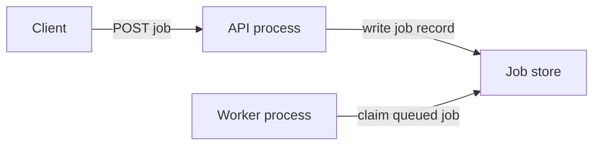

---
{
  "id": "diagram-mermaid-flow-boundaries",
  "kind": "notation",
  "title": "Mermaid flowcharts: explicit boundary and relationship semantics",
  "summary": "Use lightweight source-controlled nodes, labeled edges and subgraphs for a focused structural or flow sketch without inferring architecture from layout.",
  "status": "curated",
  "availability": "public",
  "facets": {
    "tasks": [
      "diagram",
      "document",
      "trace"
    ],
    "contexts": [
      "source-controlled-diagrams",
      "structural-view"
    ],
    "qualities": [
      "understandability",
      "evolvability"
    ],
    "scale": [
      "cross-scale"
    ]
  },
  "sources": [
    {
      "url": "https://mermaid.js.org/syntax/flowchart.html",
      "title": "Mermaid Flowchart syntax",
      "locator": "Nodes/edge labels; subgraphs; direction limitation; escaping warnings",
      "revision": "Official docs display Mermaid 12.3.0; mutable page inspected 2026-11-07, not an installed-version observation"
    },
    {
      "url": "https://c4model.com/diagrams/notation",
      "title": "C4 Notation",
      "locator": "Relationship labels, element type and diagram key",
      "revision": "Mutable official documentation inspected 2026-11-07"
    }
  ],
  "evidence": {
    "mode": [
      "source-inspected"
    ],
    "inspected_at": "2026-11-07",
    "freshness": "live-at-inspection",
    "scope": "Fresh official documentation text and selected source examples inspected. No source diagram image was visually viewed, and no parser, renderer, installed tool, generated output or system interaction was executed in this curation. The coordinator later syntax-checked this card’s original sketch with Mermaid 12.3.0 and DOM support; no rendering, source-image viewing or system validation was performed."
  },
  "reuse": "Original annotations and source links only. No upstream images, manuals, implementations or packages redistributed; source-specific asset reuse rights must be checked before copying.",
  "related": [
    "diagram-c4-context-container",
    "diagram-mermaid-parse-boundary"
  ]
}
---

# Mermaid flowcharts: explicit boundary and relationship semantics

## When to use

Use for a small architecture view that should live beside its explanation and change with it. A flowchart can represent dependency, data movement or decision flow, but the author must choose and label one coherent meaning.

## What to inspect

The official grammar supports labeled nodes/edges and named subgraphs. Its warnings cover reserved-looking text and arrow ambiguities. An external connection to a subgraph's internal node can override its local direction. Do not rely on placement alone to communicate isolation or ordering.

## Diagram implications

Use stable identifiers, understandable display labels and a caption naming the view's scope/status. Explain what a subgraph boundary means. If the edges are requests rather than imports, state that; mixing both silently is misleading. Validate source with the actual supported renderer/parser version, then inspect the rendered result when visual readability is part of the promise.

Original proposed sketch, syntax-checked later with Mermaid 12.3.0, not rendered:

## What to borrow and adapt

Keep the diagram small enough to answer one question and put missing guarantees in accompanying text. For this sketch, the source of atomic claim behavior and the meaning of acknowledgment still need specification; adding another arrow would not prove them.

## Mismatches and limits

Flowchart syntax does not validate ownership, transaction boundaries or deployed connections. Text inspection is not visual inspection, and an accepted graph definition is not system verification. Renderer feature support varies; the displayed documentation version is not the version bundled by a Markdown host. No hosted editor or source upload was used here.
