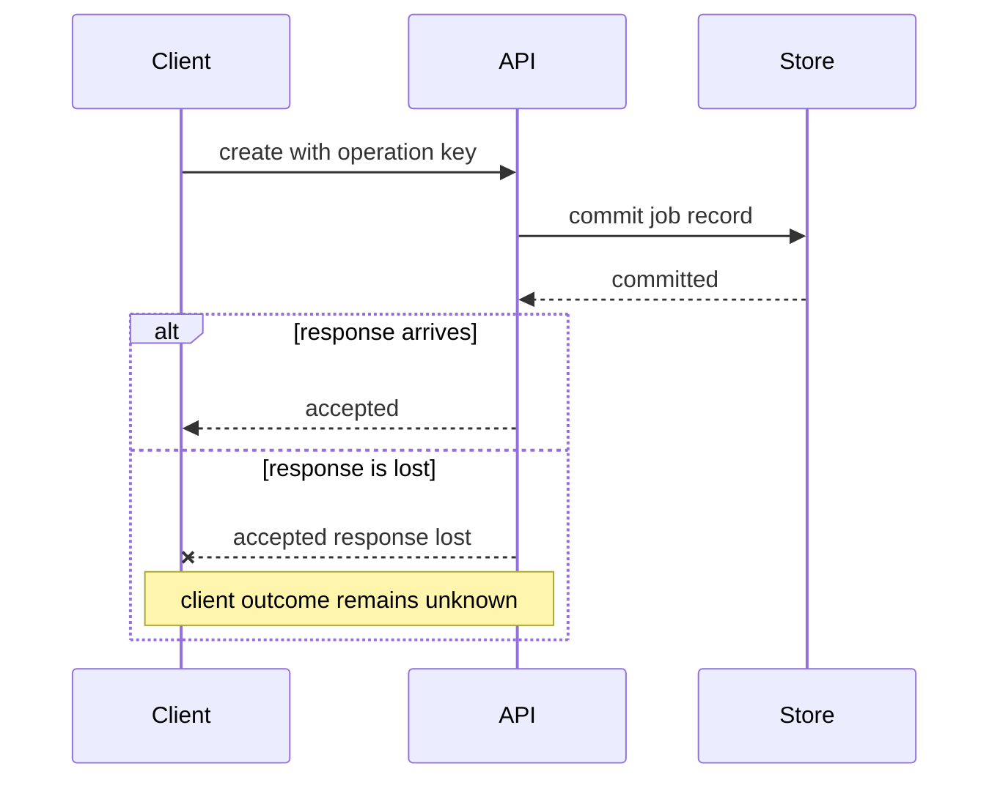

---
{
  "id": "diagram-mermaid-sequence-outcomes",
  "kind": "notation",
  "title": "Mermaid sequence diagrams: separate order, branches and observations",
  "summary": "Expose a consequential interaction order and uncertain outcome using explicit participants, message labels and alternate paths.",
  "status": "curated",
  "availability": "public",
  "facets": {
    "tasks": [
      "diagram",
      "trace",
      "model-failure"
    ],
    "contexts": [
      "source-controlled-diagrams",
      "runtime-scenarios"
    ],
    "qualities": [
      "reliability",
      "consistency"
    ],
    "scale": [
      "cross-scale"
    ]
  },
  "sources": [
    {
      "url": "https://mermaid.js.org/syntax/sequenceDiagram.html",
      "title": "Mermaid Sequence diagrams",
      "locator": "Participants, supported message arrows, alt/opt/loop/par sections; Entity codes to escape characters (semicolon message text)",
      "revision": "Official docs display Mermaid 12.3.0; mutable page inspected 2026-11-07, not an installed-version observation"
    },
    {
      "url": "https://c4model.com/diagrams/dynamic",
      "title": "C4 Dynamic diagram",
      "locator": "Feature-scoped ordered interactions, selective use",
      "revision": "Mutable official documentation inspected 2026-11-07"
    }
  ],
  "evidence": {
    "mode": [
      "source-inspected"
    ],
    "inspected_at": "2026-11-07",
    "freshness": "live-at-inspection",
    "scope": "Fresh official documentation text and selected source examples inspected. No source diagram image was visually viewed, and no parser, renderer, installed tool, generated output or system interaction was executed in this curation. The coordinator later syntax-checked this card’s original sketch with Mermaid 12.3.0 and DOM support; no rendering, source-image viewing or system validation was performed. The coordinator also read the official entity-code rule after development outputs exposed unescaped message semicolons."
  },
  "reuse": "Original annotations and source links only. No upstream images, manuals, implementations or packages redistributed; source-specific asset reuse rights must be checked before copying.",
  "related": [
    "foundation-end-to-end-guarantees",
    "system-nats-delivery-effects"
  ]
}
---

# Mermaid sequence diagrams: separate order, branches and observations

## When to use

Use when an acknowledgment, retry or asynchronous handoff is central to the design question. A sequence view can distinguish what an owner committed from what a client knows.

## What to inspect

Mermaid's message types, participant declarations and branch/parallel blocks have distinct syntax. Read the actual arrow semantics rather than assuming dashed always means failure or async. The docs identify open-arrow message forms for async communication. Labels and branch conditions still carry the product meaning.

## Diagram implications

Name the scenario, its precondition and the observation point. Avoid treating a vertical gap as a measured duration. Make concurrency explicit if relevant; a drawn order is otherwise only the authored scenario. Add the consequential uncertain/failure branch without asserting an unimplemented recovery mechanism.

Original proposed sketch, syntax-checked later with Mermaid 12.3.0, not rendered:

## What to borrow and adapt

Before treating source as complete, check message-label syntax: semicolons separate Mermaid statements, so use readable rephrasing or the documented `#59;` entity for a literal message semicolon. Manual architecture review does not establish grammar validity.

Use the mismatch between a committed record and a lost response to ask where reconciliation or idempotency belongs. Do not add a successful retry merely because the sequence notation can draw it. For another question, a short numbered interaction list may suffice.

## Mismatches and limits

The example is a hypothetical design fragment, not a verified API, timing trace or exactly-once guarantee. A sequence omitting a crash is not evidence that the crash is impossible. Tool grammar and actual communication semantics need separate checks. No image, renderer, network interaction or failure injection was observed.
