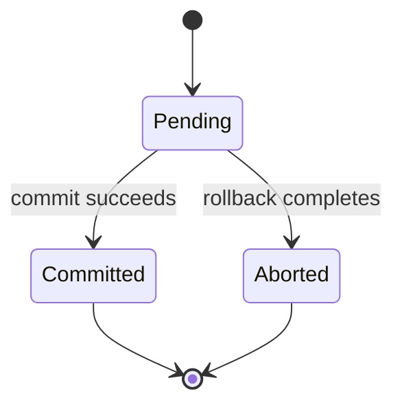

---
{
  "id": "diagram-mermaid-state-ownership",
  "kind": "notation",
  "title": "Mermaid state diagrams: model one owned lifecycle",
  "summary": "Use explicit transitions and composite/concurrent structure when the key question is legal state change, while separating client observations from authoritative state.",
  "status": "curated",
  "availability": "public",
  "facets": {
    "tasks": [
      "diagram",
      "model-failure",
      "document"
    ],
    "contexts": [
      "state-machines",
      "source-controlled-diagrams"
    ],
    "qualities": [
      "consistency",
      "reliability"
    ],
    "scale": [
      "cross-scale"
    ]
  },
  "sources": [
    {
      "url": "https://mermaid.js.org/syntax/stateDiagram.html",
      "title": "Mermaid State diagrams",
      "locator": "States/transitions, start/end, composite states, choice, fork/join and concurrency",
      "revision": "Official docs display Mermaid 12.3.0; mutable page inspected 2026-11-07, not an installed-version observation"
    },
    {
      "url": "https://docs.arc42.org/section-6/",
      "title": "arc42 Runtime view",
      "locator": "Runtime scenario purpose and state-machine option",
      "revision": "Mutable official documentation inspected 2026-11-07"
    }
  ],
  "evidence": {
    "mode": [
      "source-inspected"
    ],
    "inspected_at": "2026-11-07",
    "freshness": "live-at-inspection",
    "scope": "Fresh official documentation text and selected source examples inspected. No source diagram image was visually viewed, and no parser, renderer, installed tool, generated output or system interaction was executed in this curation. The coordinator later syntax-checked this card’s original sketch with Mermaid 12.3.0 and DOM support; no rendering, source-image viewing or system validation was performed."
  },
  "reuse": "Original annotations and source links only. No upstream images, manuals, implementations or packages redistributed; source-specific asset reuse rights must be checked before copying.",
  "related": [
    "foundation-transaction-isolation",
    "system-sqlite-commit-boundaries"
  ]
}
---

# Mermaid state diagrams: model one owned lifecycle

## When to use

Use when lifecycle and transition authority matter more than a list of collaborating services. Examples include a lease, job, transaction or replicated-record state; define the modeled object and owner before selecting names.

## What to inspect

The official state grammar supports transitions, start/end markers, composite states and concurrent regions. It restricts transitions between internal states of different composite states. Syntax can express a finite abstraction but cannot establish whether a real system enforces it.

## Diagram implications

Label transition events/conditions and distinguish durable state from a client's uncertain observation. A terminal marker ends the modeled lifecycle; it does not necessarily delete the record. Concurrent regions need actual independent state meanings, not decorative grouping. Pair a state view with a sequence when knowing who caused a transition is the unresolved issue.

Original proposed transaction abstraction, syntax-checked later with Mermaid 12.3.0, not rendered:

## What to borrow and adapt

Use a short transition table alongside the diagram to identify owner, guard and source evidence. For this abstraction, lock/sync/recovery internals are deliberately omitted. Whether a client timed out is a separate observation, not an automatic transition from Committed to Aborted.

## Mismatches and limits

This sketch does not model a complete database protocol, prove atomicity or supply test coverage. The grammar's composite/concurrent features are not a reason to overmodel every implementation detail. Rendering, state-space analysis and implementation conformance are distinct checks; none occurred here.
