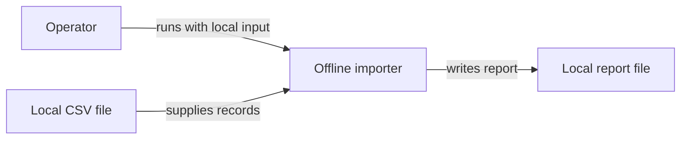
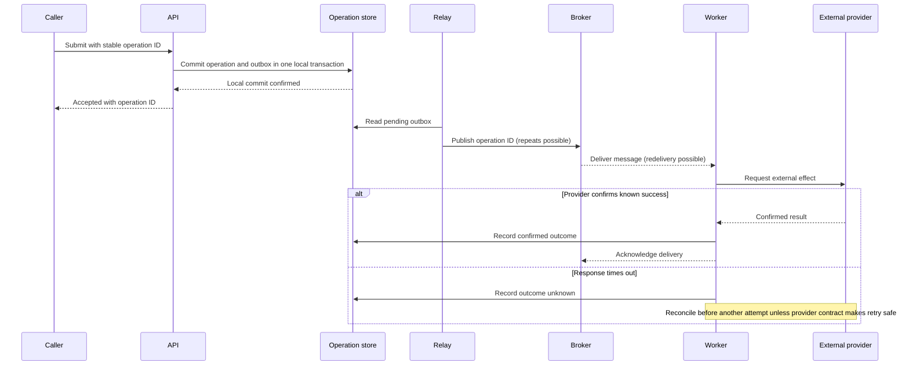
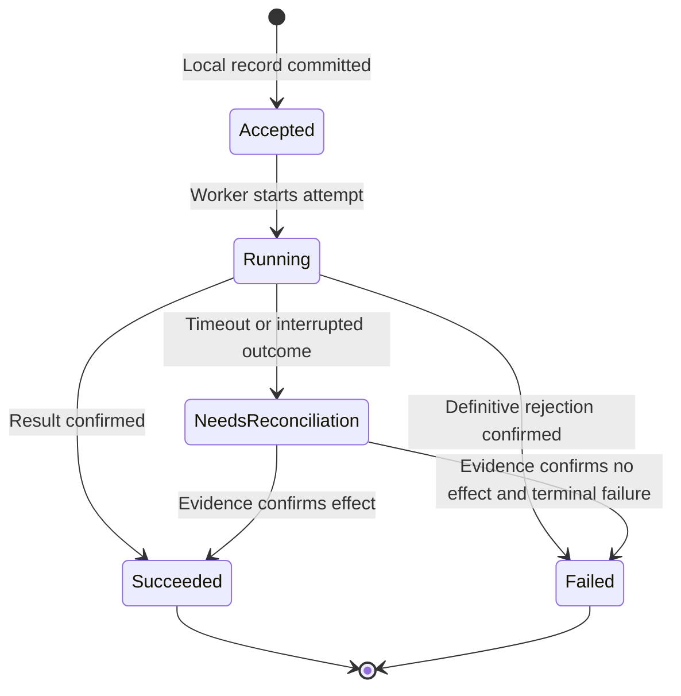
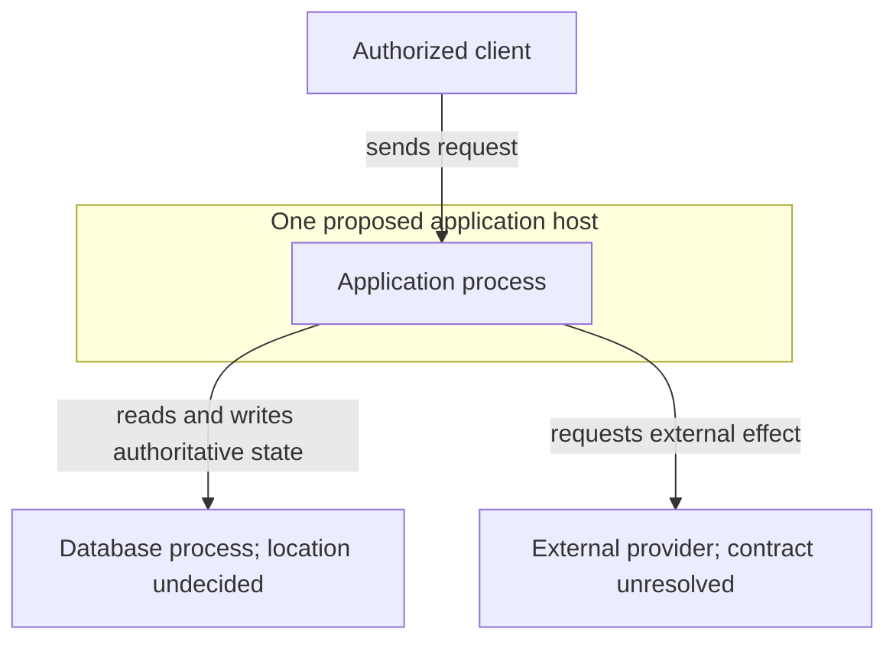

# Diagram contract and original examples

Choose views to answer a particular stakeholder question. These original examples are illustrative proposals, not diagrams of an inspected or deployed product. They are editable Mermaid source, syntax-checked using Mermaid 12.3.0 on 2026-11-07. They were not rendered; syntax success does not establish visual readability or architectural correctness.

## What the view promises

| View | Useful question | Expose | Do not imply |
| --- | --- | --- | --- |
| Context | Who uses the system and which external systems matter? | Actors, system scope, external dependencies and relationship purpose. | Internal deployment, transactionality or runtime sequence. |
| Structure/dependency | Which part owns a responsibility or decision? | Boundary kind, interfaces and dependency/call meaning. | Every module is a separately deployed service. |
| Runtime/sequence | How does an operation complete or fail? | Participants, order, sync/async meaning, state changes, acknowledgment and alternate outcomes. | An arrow guarantees delivery, durability or atomic external effects. |
| State | What outcomes/transitions are valid? | State owner, triggers, terminal/uncertain conditions and reconciliation. | Every drawn transition is implemented or reachable. |
| Deployment | Where do executable instances and data live? | Environment/status, instances/locations, network/trust boundaries and external systems. | A C4 logical container means a Docker container, or guessed replicas are observed production. |

For each substantive diagram, identify question, scope, current/proposed/inferred/unknown status and source/assumption locators. Give important relationships a verb and direction. If line style has meaning, supply a legend. Keep names and guarantees consistent across diagrams/prose; use separate views or explicit grouping when logical components and runtime instances differ.

A source-based current-state model needs a trace from consequential nodes/edges to inspected code/config/contracts. If deployment evidence is absent, omit replica/location claims or show them as unknown. A proposed diagram should identify the assumptions and policy decisions still required. Do not use a legend to hide uncertainty only in fine print.

## Example: minimal context, not mandatory infrastructure

Question: which inputs/outputs belong to a small offline reporting tool? **Status: illustrative proposal.** The source file is external input, the importer is one application and the report is output. Arrows distinguish invocation from data transfer through their labels; they do not mean deployment or network calls.

This view does not require a database, queue, web API or container platform. It does not show parser internals or establish safe file replacement; use a separate behavior/state view if that is the decision.

## Example: acceptance and an uncertain external effect

Question: where can a proposed asynchronous operation become uncertain? **Status: illustrative proposal.** Assumptions: one local transaction can persist the operation and outbox; the broker may redeliver; the external provider's retry/idempotency contract is unresolved. “Accepted” is not business completion. No automatic external retry is promised after timeout.

The picture does not prove relay durability, worker serialization, deduplication or provider exactly-once behavior. An acknowledgment lost after success still needs an operation-specific policy. Refine the model from actual contracts rather than adding “exactly once” to the broker arrow.

## Example: keep uncertainty out of false failure

Question: how should the operation's recorded status distinguish known failure from unknown outcome? **Status: illustrative state model**, owned by the operation store. Transitions are proposed semantic rules, not observed implementation.

Unknown outcome is not automatically failed or safe to resubmit. The model deliberately does not define cancellation/refund or retry transitions; those need actual product/provider policy. A sequence and state view should agree about which evidence permits a terminal outcome.

## Example: deployment is a separate proposal

Question: what process/storage relationships would one proposed deployment have? **Status: illustrative deployment proposal**, not current production. Arrow labels mean runtime access; this is not an import graph.

The database location, redundancy, recovery and access policy are not established. Add instances, zones or trust boundaries only when evidence or an explicit proposal supports them. More boxes would not make this design more available.

## Review before delivery

Mermaid message text has syntax rules too. In sequence diagrams an unescaped semicolon can terminate a statement; rephrase the label or use the documented `#59;` entity for a literal semicolon. See the official [sequence entity-code rule](https://mermaid.js.org/syntax/sequenceDiagram.html#entity-codes-to-escape-characters). Do not assume readable prose inside an arrow is automatically valid source, or claim that a manual semantic review parsed it.

Check syntax using the requested renderer/parser when available; report the actual version. Inspect rendering for readable labels, edge direction, zoom and layout if visual output is promised. Then separately check whether the diagram tells the truth: source correspondence, state/transaction authority, time/order, failure path and agreement with the written decision. A syntax-valid diagram can still be false, and a correct source model may not yet have been rendered.
